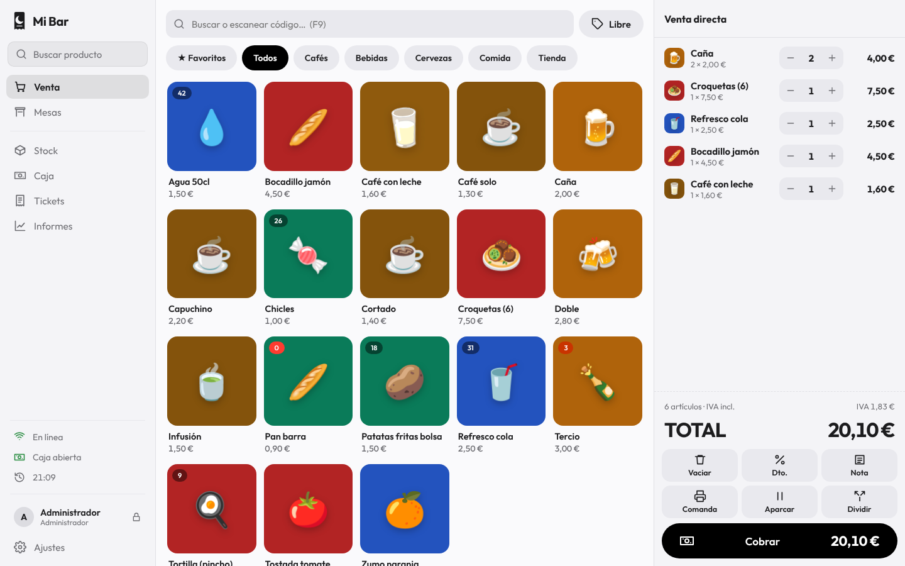
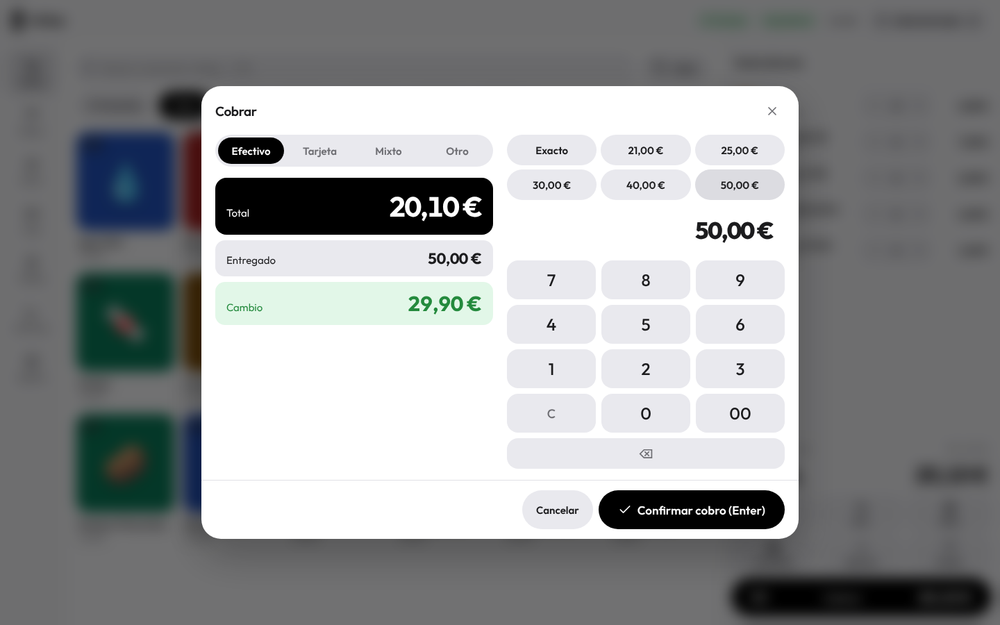
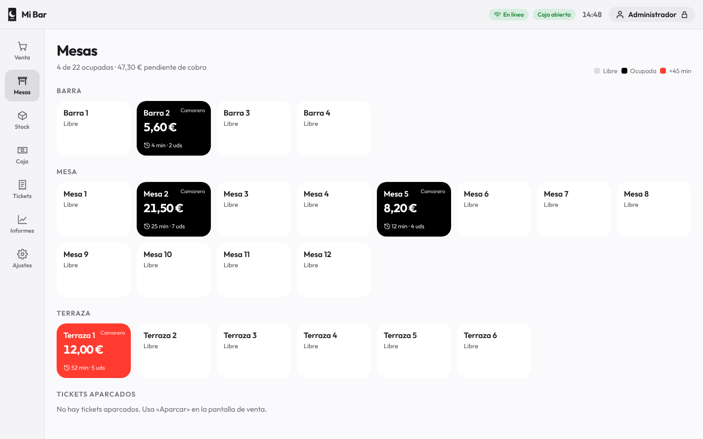
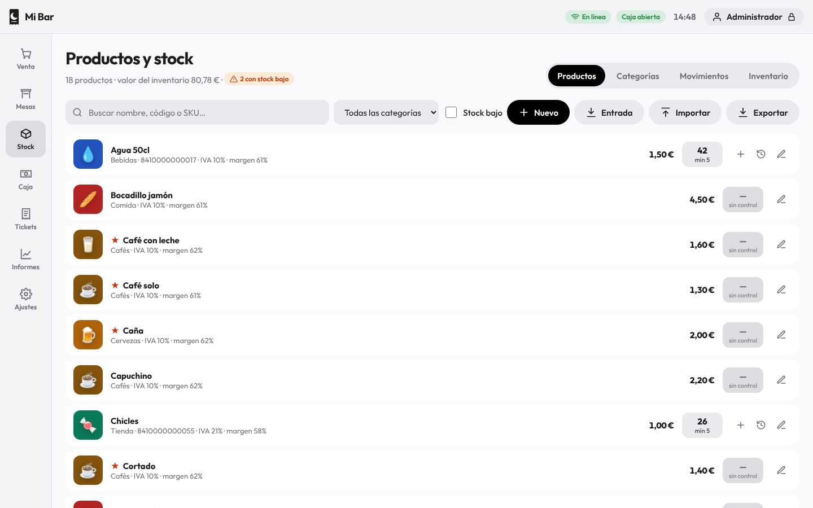
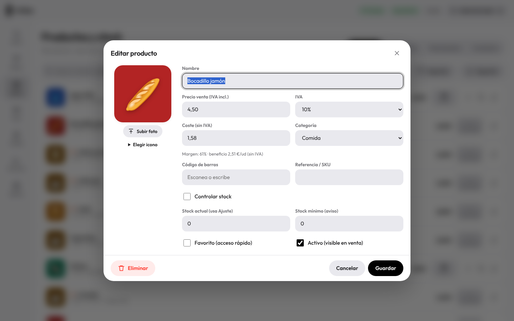
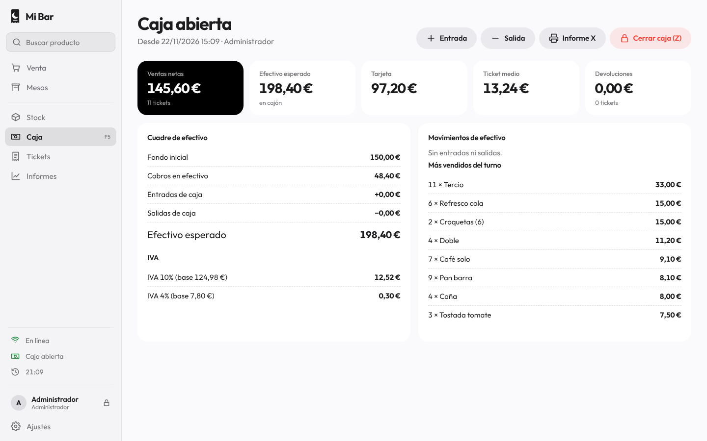
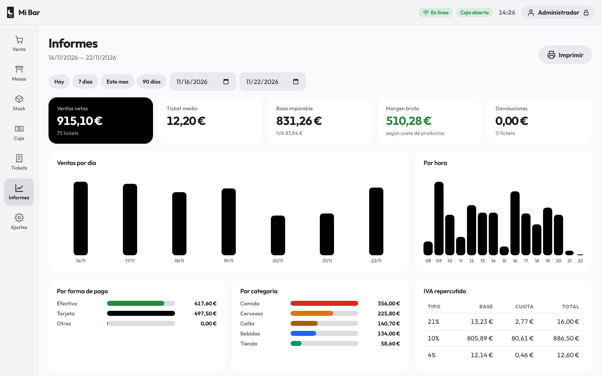
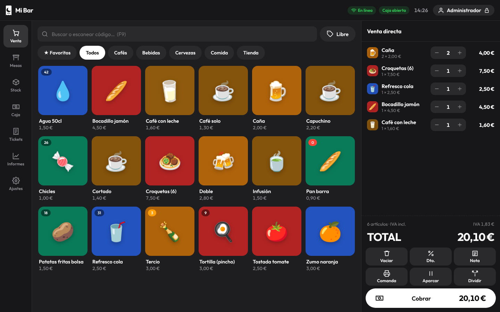
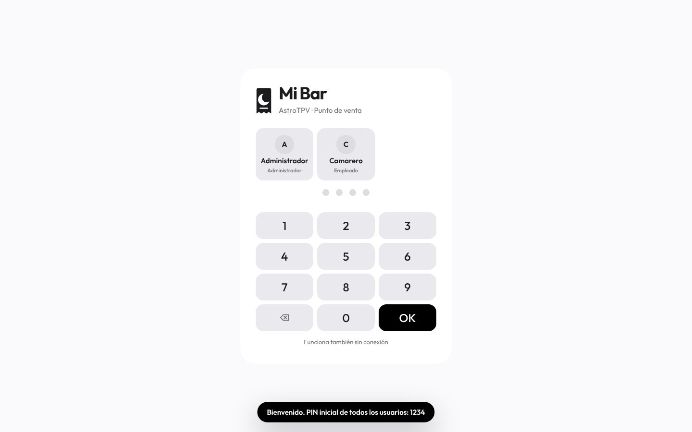
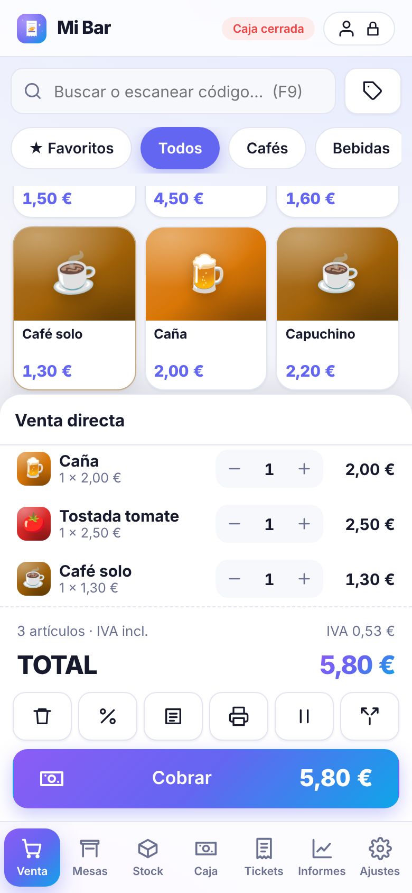

<div align="center">


# AstroTPV

**Punto de venta para bares, cafeterías y tiendas.**
Cobros, mesas, stock, cierre de caja y tickets. **Funciona 100 % sin internet.**

[](https://github.com/AstroSoftwareMoon/AstroTPV/actions/workflows/ci.yml)
[](https://github.com/AstroSoftwareMoon/AstroTPV/actions/workflows/release.yml)
[](https://astrosoftwaremoon.github.io/AstroTPV/)



</div>

## ✨ Funciones

| | |
|---|---|
| 🛒 **Venta táctil** | Productos con foto o icono, categorías con color, favoritos, buscador, artículo libre, notas por línea, descuentos por línea y por ticket |
| 📷 **Lector de códigos** | Compatible con cualquier lector USB/Bluetooth (modo teclado). Soporta `3*código` para cantidades |
| 💶 **Cobro** | Efectivo con cálculo de cambio y billetes sugeridos, tarjeta, mixto (tarjeta + efectivo) y otros (Bizum, vales…) |
| 🍽️ **Mesas** | Zonas configurables (`Mesa 1-12, Terraza 1-6, Barra`), tiempo abierto, aviso a los 45 min, mover/unir mesas, aparcar tickets |
| ✂️ **Dividir cuenta** | Por productos o a partes iguales |
| 🧾 **Tickets** | Factura simplificada con desglose de IVA, comandas para cocina, reimpresión, papel 58/80 mm o A4 |
| ↩️ **Devoluciones** | Totales o parciales, con factura rectificativa (serie propia) y reposición de stock |
| 📦 **Stock** | Control por producto, alertas de stock bajo, entradas de proveedor, mermas, ajustes, inventario completo, historial, coste y margen |
| 🔐 **Caja** | Apertura con fondo, entradas/salidas de efectivo, informe X, cierre Z con contador de billetes y monedas y cálculo de descuadre |
| 📊 **Informes** | Ventas por día y hora, por categoría y forma de pago, IVA repercutido, margen bruto, productos más vendidos |
| 👥 **Usuarios** | Acceso por PIN (cifrado SHA-256), roles empleado/administrador, autorización puntual de administrador, bloqueo por inactividad |
| 📝 **Auditoría** | Registro de aperturas, cierres, devoluciones, descuentos, borrados… |
| 💾 **Datos** | Todo en el dispositivo (IndexedDB) con operaciones atómicas. Copias de seguridad JSON, importar/exportar CSV |
| 🌗 **Diseño** | Tema claro/oscuro, adaptado a PC, tablet y móvil, instalable como app |

## 🖼️ Capturas

| Cobro | Mesas |
|---|---|
|  |  |
| **Stock** | **Ficha de producto con foto/icono** |
|  |  |
| **Caja** | **Informes** |
|  |  |
| **Modo oscuro** | **Inicio de sesión** |
|  |  |

<p align="center"></p>

## 🚀 Cómo usarlo

### Opción 1 · App de escritorio (Windows, Linux, macOS)
Descarga el instalador de la última [Release](https://github.com/AstroSoftwareMoon/AstroTPV/releases):

- **Windows**: `AstroTPV-x.y.z-win-x64.exe` (instalador) o `AstroTPV-x.y.z-portable.exe` (sin instalar)
- **Linux**: `.AppImage` o `.deb`
- **macOS**: `.dmg`

> En Windows/macOS puede aparecer un aviso de “editor desconocido” porque los binarios no están firmados.
> Arranque en modo kiosco (pantalla completa fija): `AstroTPV --kiosk`.

### Opción 2 · Web instalable (PWA)
Abre **https://astrosoftwaremoon.github.io/AstroTPV/**, pulsa **Instalar** en el navegador y listo:
desde ese momento abre y funciona **sin conexión**, también en tablets Android e iPad.

### Opción 3 · En local
```bash
npm start            # http://localhost:8080
```
No necesita dependencias: es HTML + CSS + JavaScript puro.

**Usuarios iniciales:** Administrador y Camarero, ambos con PIN `1234`. La primera vez que entra el administrador, AstroTPV le recomienda cambiar su PIN; los demás se cambian en *Ajustes → Usuarios*.

## ⌨️ Atajos

| Tecla | Acción |
|---|---|
| `F1` `F2` `F3` `F5` `F6` `F7` `F8` | Venta, Mesas, Stock, Caja, Tickets, Informes, Ajustes |
| `F9` | Buscar / escanear |
| `F4` o `Ctrl+Enter` | Cobrar |
| `Enter` | Confirmar el diálogo |
| `Esc` | Cerrar diálogo |
| Clic derecho en producto | Añadir con cantidad |

## 🖨️ Impresoras de tickets
AstroTPV imprime con el diálogo del sistema, así que vale cualquier impresora térmica con driver (Epson, Star, Xprinter…).
Elige el ancho de papel en *Ajustes*. Para imprimir sin diálogo en Chrome/Edge usa el parámetro `--kiosk-printing`.

## 🏗️ Compilación en GitHub

| Workflow | Cuándo | Qué hace |
|---|---|---|
| `ci.yml` | Cada push / PR | Sintaxis, tests unitarios, test E2E en Chromium (venta, mesas, división, stock, devolución, cierre Z y modo offline) y build web |
| GitHub Pages | Cada push a la rama por defecto | Publica la web en https://astrosoftwaremoon.github.io/AstroTPV/ (*Settings → Pages → Deploy from a branch*, carpeta raíz) |
| `release.yml` | Etiqueta `v*` o manual | Compila instaladores para Windows, Linux y macOS y crea la Release |

Publicar una versión:
```bash
git tag v1.0.0 && git push origin v1.0.0
```

## 🧪 Desarrollo

```bash
npm test             # tests unitarios (node:test)
npm run test:e2e     # prueba completa en navegador (requiere Playwright)
npm run screenshots  # regenera las capturas de docs/
npm run icons        # regenera los PNG del icono desde el SVG
npm install && npm run desktop   # abre la app de escritorio
npm run dist         # crea el instalador para tu sistema
```

### Estructura
```
index.html, sw.js, manifest.webmanifest   App y modo offline (PWA)
css/app.css                               Estilos (tema claro/oscuro, responsive, impresión)
js/core.js                                Lógica pura: importes en céntimos, IVA, totales, informes, CSV
js/db.js                                  IndexedDB con transacciones atómicas
js/ui.js                                  Componentes: modales, teclado numérico, toasts, iconos
js/app.js                                 Arranque, login, carrito, registro de ventas, tickets
js/views/*.js                             Venta, Mesas, Stock, Caja, Tickets, Informes, Ajustes
electron/main.js                          App de escritorio
tests/                                    Tests unitarios y E2E
```

Todos los importes se guardan en **céntimos enteros** para evitar errores de redondeo, y el desglose de IVA reparte los descuentos cuadrando al céntimo.

## 📄 Licencia
MIT
